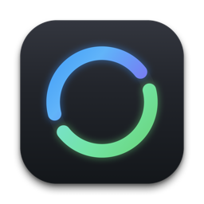

# BreakLoop (专注循环)

<p align="center">
  
</p>

<p align="center">
  <strong>专为 macOS 打造的高质感模块化专注与工休循环健康管理工具</strong>
</p>

<p align="center">
  
  
  
  
</p>

---

## 💡 为什么选择 BreakLoop？

传统的番茄钟或休息软件往往过于死板：
- 只有简单的「工作 - 休息」两步交替，无法适应真实多变的工作流；
- 离开座位或电脑屏保锁屏后，时间依然在傻傻空跑，污染统计数据；
- 统计图表粗糙，看不清全天工休节奏与精确比例；
- 休息被强制弹窗打断，无法从容掌控节奏。

**BreakLoop** 重新思考了人与电脑的节奏协作：
它不仅支持**任意工休模块自由拼装流水线**，还拥有类似 **Apple Watch 运动圆环** 的双弧流转比例表盘与 **7×24 小时微环热力图**，并具备**屏幕保护与离座回溯待机**能力，是一款兼具极致视觉美感与强大工程哲学的 macOS 原生效率神器。

---

## ✨ 核心特性

### 1. 🎛️ 专注仪表台 (Focus Dashboard)
- **实体凹槽发光流转表盘**：直观展示当前模块倒计时/正计时进度，双弧平滑流转。
- **灵活计时操控**：支持快速开始、暂停/继续、跳至下一步、一键待机以及重置整轮循环。
- **持久化循环轮数**：切换方案或调整配置不丢失当前累计轮数，真实度量一天的成就感。
- **可视化步骤队列**：清晰展示循环序列，随时点击卡片任意跳转步骤。

### 2. 🔀 模块化流水线方案管理 (Pipeline Engine)
- **多步循环拼装**：打破传统二元限制，自由组合任意工休流程（例如：*20m 专注 ➔ 20s 远眺 ➔ 30m 深度攻坚 ➔ 5m 闭目养神 ➔ 15m 运动大休*）。
- **专注与多样化休息**：
  - **专注模块**：严格倒计时，确保心流沉浸。
  - **固定倒计时休息**：带有到点提示与稍后提醒延时。
  - **自由正计时休息**：专门为 20-20-20 护眼法则等轻量休息打造，达标轻提示，时间自然流动不强制打断。
- **方案管理解耦**：列表点击只改不启，安全预览编辑；提供「应用为下轮默认」（平滑过渡）与「立即启用」双模式。
- **自定义打断恢复策略**：针对「手动进入待机」与「被动离开待机」，每个方案可独立设定恢复行为（*重置本步 / 断点续传 / 重置整轮*）。

### 3. 📊 双弧流转比例圆环与专注热力图 (Dual-Arc Stats)
- **Apple Watch 级双弧圆环 (`DualArcRingView`)**：专注蓝与薄荷绿双弧端对端闭环流转，内嵌凹槽底轨，无论高低频工休均清晰可见。
- **四维全景深度洞察**：
  - **周视图**：7×24 小时微圆环矩阵（每格代表 60 分钟标准环），鼠标悬停实时呈现工休时长、工休比与具体时段范围。
  - **日视图**：24 小时对比环轨与流水账时间轴。
  - **月视图**：日历格子以每日环状图呈现工休强度，支持点击穿透钻取日视图。
  - **年视图**：12 个月度宏观对比圆环，支持点击穿透钻取月视图。
- **数据自主掌控**：支持一键导出 CSV 原始数据明细。

### 4. 🔔 声音与提醒中心 (Sound & Alerts)
- **多样化提醒形式**：弹窗与声音、仅声音、仅弹窗、完全静音随心选择。
- **全局声音与文案预设**：可为专注与休息独立设定默认提示音与默认提醒文案，新建步骤自动继承。
- **一键全局覆盖**：支持独立将默认提示音或提醒文案一键覆盖同步至所有方案模块。
- **多轮重复与长音智能截断**：
  - 提示音连续重复播放（1~5 次），避免因走开遗漏；
  - 长音频防疲劳保护：播放最长持续可控（10~15 秒），并在末尾 2 秒平滑淡出渐弱。
- **自定义音频库**：支持导入个人音频（`.wav`, `.mp3`, `.m4a`, `.aiff`, `.caf`），独立音量调节。

### 5. 🖥️ 屏保感知与离开自动回溯 (Smart Idle & Standby)
- **原生接入系统事件**：实时监听 macOS 屏幕保护程序（`com.apple.screensaver.didstart`）与用户键鼠无操作闲置。
- **离开时间智能回溯**：用户离开导致自动转入待机时，**自动扣除离开期间的时间**，杜绝把离座摸鱼误计为专注或休息。
- **暂停超时保护**：暂停过久（可配 3m / 5m / 10m / 15m / 从不）自动收起进待机，避免遗忘挂机。

### 6. 🚀 菜单栏驻留与轻量小组件 (Menu Bar & Widget)
- **原生 Menu Bar 常驻**：动态显示当前步骤名、序号与时间。
- **快捷弹出面板**：在菜单栏中快速掌控进度与切换方案。
- **macOS 桌面小组件**：支持通过 WidgetKit 桌面小组件随时查看工休状态。

---

## 🛠️ 技术栈与架构设计

- **Language**：Swift 5.9+
- **Frameworks**：SwiftUI, AppKit, WidgetKit, Combine, AVFoundation, UniformTypeIdentifiers
- **Architecture**：
  - `TimerEngine`：单向数据流计时核心，高精度时间差补偿与防挂机保护。
  - `IdleMonitor`：底层 IOKit / CoreGraphics 闲置捕获与 DistributedNotificationCenter 屏保事件监听。
  - `PresetStore` / `SessionStore`：本地持久化与数据完整性校验。
  - `DualArcRingView`：高性能声明式双弧几何绘制引擎。
- **Tests**：内置 14 项完整单元测试覆盖，涵盖崩溃恢复、打断续传、回溯扣除、循环调度与声音截断规则。

---

## 📦 构建与运行

### 系统要求
- macOS 13.0 (Ventura) 或更高版本
- Xcode 15.0+

### 本地编译

1. **克隆仓库**
   ```bash
   git clone https://github.com/Minato-chen/BreakLoop.git
   cd BreakLoop
   ```

2. **使用 XcodeGen 生成工程（可选）**
   ```bash
   xcodegen generate
   ```

3. **运行单元测试**
   ```bash
   swift test
   ```

4. **使用 xcodebuild 编译并安装**
   ```bash
   xcodebuild -project BreakLoop.xcodeproj -scheme BreakLoop -configuration Debug build
   ```
   编译生成的 `BreakLoop.app` 位于 Xcode DerivedData 产物目录中，可直接移入 `/Applications` 运行。

---

## 📄 开源许可证

本项目基于 [MIT License](LICENSE) 开源。欢迎贡献代码、提出 Issue 或反馈建议！
